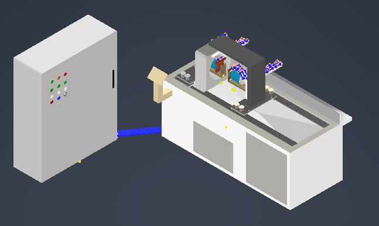
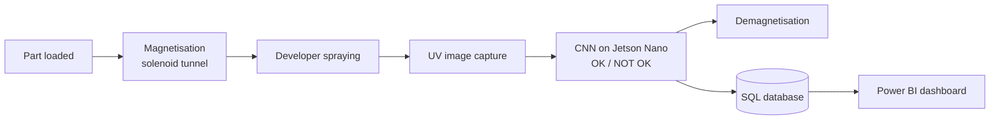

# Semi-Automated Magnetic Particle Inspection Bench with Embedded AI

Final-year engineering project (2025) at **Marlier Maroc**, a non-destructive testing (NDT) company
serving the aerospace, automotive and heavy industry sectors.

## Problem
Magnetic particle inspection (MPI) finds surface defects on ferromagnetic parts. Done by hand, it is
slow, depends on the operator's eye, and leaves little traceability.

## Solution
A semi-automated bench that chains magnetisation, developer spraying and demagnetisation, and
analyses the UV images with embedded AI.

## 3D mechanical design
Full bench modelled in **Autodesk Inventor**: modular frame, part holder, pole pieces,
custom-sized solenoid tunnel, spraying system and UV inspection tunnel.

## Automation & HMI
- **Siemens S7-1200** program in **TIA Portal**: general GRAFCET, emergency-stop GRAFCET and one
  macro-step per stage (magnetisation, spraying, inspection, demagnetisation), translated to Ladder
- **Touch HMI**: home, control and supervision screens, with the four magnetisation methods (M1–M4)
  and live temperature, lux, UV and field intensity readings

## Embedded AI
- CNN models (**VGG16**, **EfficientNetB0**, Keras) trained with data augmentation on UV inspection images
- Deployed on an **NVIDIA Jetson Nano** for real-time analysis: **96 % accuracy**
- **Gradio** interface to review predictions, correct labels and retrain

## Traceability
Inspection results stored in a **SQL database**, with a **Power BI** dashboard for reporting.

## Stack
Autodesk Inventor · Siemens S7-1200 · TIA Portal · GRAFCET / Ladder · HMI · Python · Keras · OpenCV ·
Jetson Nano · Gradio · SQL · Power BI
