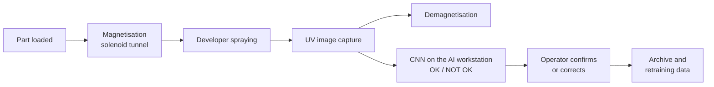
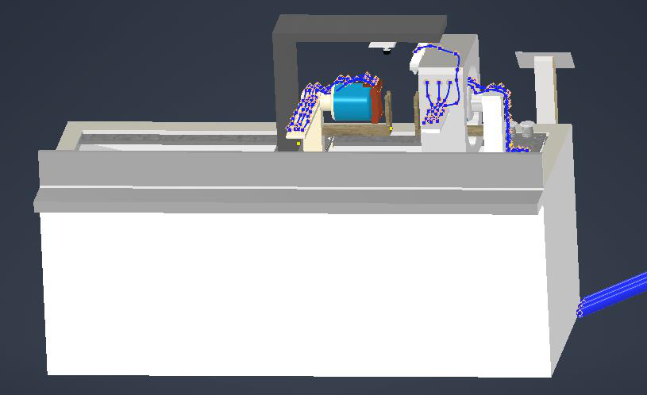
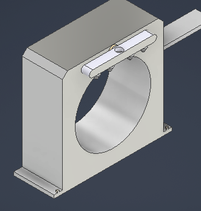
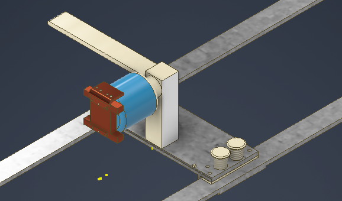
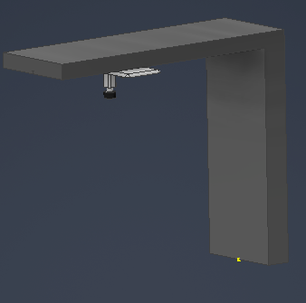
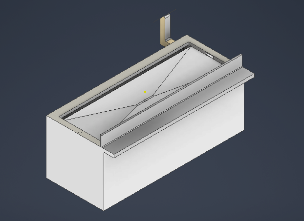
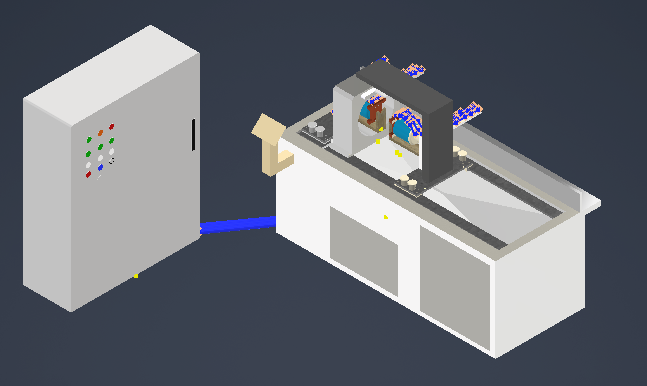
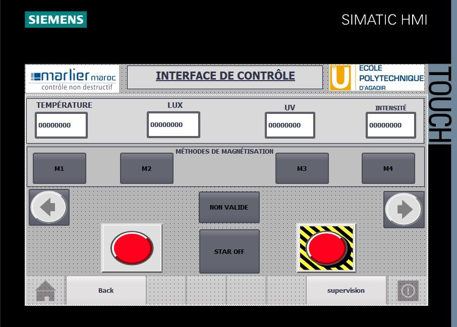
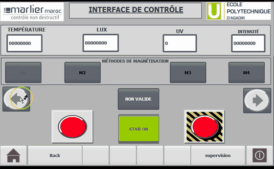

# Semi-Automated Magnetic Particle Inspection Bench with AI Defect Detection

Final-year engineering project (2025) at **Marlier Maroc**, a non-destructive testing (NDT) company
serving the aerospace, automotive and heavy industry sectors.


## Problem
Magnetic particle inspection (MPI) finds surface defects on ferromagnetic parts. Done by hand, it is
slow, depends on the operator's eye, and leaves little traceability.

## Solution
A semi-automated bench that chains magnetisation, developer spraying, UV inspection and
demagnetisation. An AI application on a separate workstation classifies the UV images, and the
operator confirms or corrects its result. The system was designed and validated in simulation.



## 3D mechanical design
Full bench modelled in **Autodesk Inventor**: modular frame, part holder, pole pieces,
custom-sized solenoid tunnel, spraying system and UV inspection tunnel.



| Solenoid tunnel | Pole piece carriage |
|---|---|
|  |  |
| **UV inspection arm** | **Frame and tank** |
|  |  |



## Automation & HMI
- **Siemens S7-1200** program in **TIA Portal**: general GRAFCET, emergency-stop GRAFCET and one
  macro-step per stage (magnetisation, spraying, inspection, demagnetisation), translated to Ladder
- **Touch HMI**: home, control and supervision screens, with the four magnetisation methods (M1–M4)
  and live temperature, lux, UV and field intensity readings



The PLC program and HMI were run together in simulation. Below: method selection, the machine
stages on the supervision screen, then an emergency stop.



| GRAFCET | |
|---|---|
| General cycle | [view](plc/grafcet_general.png) |
| S1 Magnetisation | [view](plc/grafcet_s1_magnetisation.png) |
| S2 Spraying | [view](plc/grafcet_s2_spraying.png) |
| S3 Inspection | [view](plc/grafcet_s3_inspection.png) |
| S4 Demagnetisation | [view](plc/grafcet_s4_demagnetisation.png) |
| Emergency stop | [view](plc/grafcet_emergency_stop.png) |

Ladder excerpts: [magnetisation timer](plc/ladder_magnetisation_timer.png),
[emergency stop](plc/ladder_emergency_stop.png). Full I/O list: [io_list.csv](plc/io_list.csv).

## AI defect detection
- **VGG16** and **EfficientNetB0** (ImageNet weights, top layers fine-tuned, 224 x 224 input, binary output)
- Data augmentation on the training images: rotation, shift, zoom, brightness, horizontal flip
- **Gradio** interface: load or capture an image, read the prediction and confidence, correct it if
  needed. Corrected images join the training data for the next retraining

**Result reported in the project:** each model classified **31 of 34 labelled images correctly
(91.2 %)**. The 34 images are 24 training images and 10 test images; on the 10 test images alone,
each model got 8 right. The dataset is small, so this is a proof of concept.

### Code
Cleaned-up version of the project notebooks, in [`ai/`](ai):

```bash
cd ai
pip install -r requirements.txt
# put your images in data/OK/ and data/NON_OK/
python train.py --model vgg16 --epochs 90      # or efficientnetb0
python app.py --model vgg16
```

Retraining with this cleaned-up code (30 epochs, 20 training images) gave 5/10 (VGG16) and 4/10
(EfficientNetB0) on the test images: more data is needed. The inspection images are not published.

## Traceability
Every analysed image is saved in a folder named after its predicted class (OK / NOT OK). Operator corrections are
kept separately as new training data.

## Stack
Autodesk Inventor · Siemens S7-1200 · TIA Portal · GRAFCET / Ladder · HMI · Python · Keras / TensorFlow ·
VGG16 · EfficientNetB0 · Gradio
